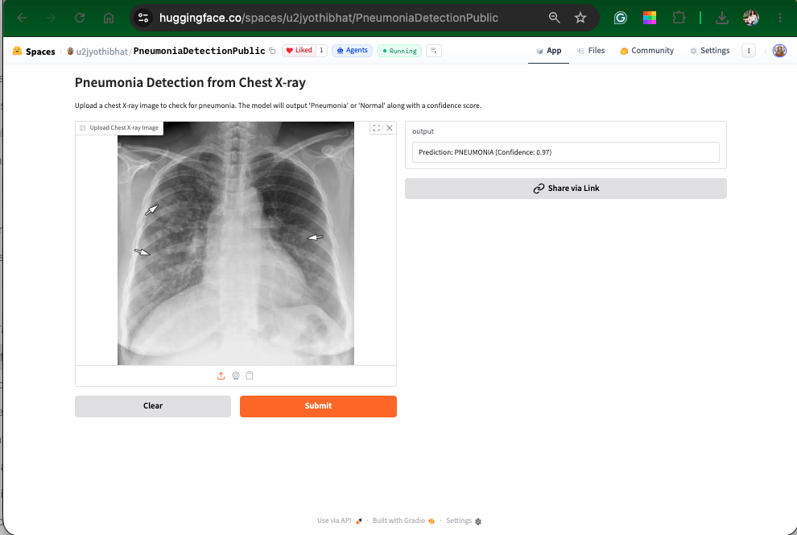
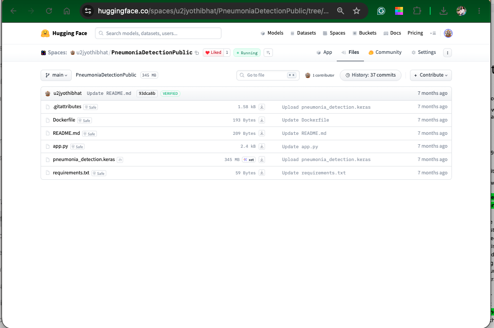

# Pneumonia Detection from Chest X-rays — PGP AIML Capstone Project

[](https://huggingface.co/spaces/u2jyothibhat/PneumoniaDetectionPublic)


This is the capstone project (Capstone Project 4: Pneumonia Detection) for the **Post Graduate Program in Artificial Intelligence and Machine Learning** from Great Lakes Executive Learning and The University of Texas at Austin McCombs School of Business, March 2025 to March 2026.

**Author:** Jyothi Kodenkiri (Jyothi K). See the [Academic e-Portfolio](https://www.mygreatlearning.com/eportfolio/jyothi-k) (certificate ID `GBQOPDDX`) and [LinkedIn](https://www.linkedin.com/in/jyothi-k-89bb423).

The project trains a deep-learning classifier on chest radiographs from the **RSNA Pneumonia Detection Challenge**. The trained model is deployed as a public web app on Hugging Face Spaces. You upload a chest X-ray and the app returns **PNEUMONIA** or **NORMAL** with a confidence score.



---

## Repository contents

| Path | What it is |
|---|---|
| `notebooks/JyothiK_PneumoniaDetection_Notebook.ipynb` | The original Google Colab notebook with all outputs. This is the working code. |
| `notebooks/JyothiK_PneumoniaDetection_Notebook.html` | HTML export of the same notebook, which you can read in any browser without Jupyter. |
| `src/pneumonia_detection.py` | The notebook as a runnable Python script. It reads the RSNA data from Google Drive in Colab, or from a local folder. |
| `app/app.py` | The Gradio application deployed on the Hugging Face Space. It is identical to the live version. |
| `app/requirements.txt`, `app/Dockerfile` | The app's dependencies and a container recipe for running it locally. |
| `report/JyothiK_PneumoniaDetection_FinalReport.pdf` | The final capstone report. |
| `images/` | Screenshots of the live app and the Space's files. |
| `requirements.txt` | Dependencies for training and evaluation. |

> The trained model (`pneumonia_detection.keras`, about 345 MB) is too large for GitHub, which limits files to 100 MB. It is stored in the [Hugging Face Space's files](https://huggingface.co/spaces/u2jyothibhat/PneumoniaDetectionPublic/tree/main). The RSNA images are licensed through Kaggle and are not redistributed here.

---

## 1. Problem and dataset

Pneumonia shows up on a chest radiograph as areas of **lung opacity**. Reading these images quickly and consistently is difficult at scale, so the project asks whether a CNN can flag likely pneumonia cases for clinicians to review first.

**Data:** [RSNA Pneumonia Detection Challenge (Kaggle)](https://www.kaggle.com/c/rsna-pneumonia-detection-challenge). The data comes as DICOM images (1024 × 1024, single channel) with two label files:

- `stage_2_train_labels.csv` holds `patientId`, the bounding box (`x`, `y`, `width`, `height`) and `Target`, which is 1 when pneumonia is present.
- `stage_2_detailed_class_info.csv` holds a three-way `class` label.

Class distribution measured in the notebook (30,227 label rows, 26,684 unique patients):

| Class | Rows | Share | Pneumonia target |
|---|---:|---:|---|
| No Lung Opacity / Not Normal | 11,821 | 39.1% | 0 (abnormal, but not pneumonia) |
| Lung Opacity | 9,555 | 31.6% | 1 (pneumonia) |
| Normal | 8,851 | 29.3% | 0 |

The third class matters because many radiographs are abnormal for reasons other than pneumonia. A model that only learns "normal versus abnormal" will raise false alarms on those images.

## 2. Method (as implemented in the notebook)

1. **Exploratory data analysis.** The notebook explores the class balance, DICOM metadata (modality, age, sex, body part, view position) and bounding boxes drawn on sample images.
2. **Preprocessing.** Each DICOM is read with `pydicom`, its pixels are normalised to [0, 1] by dividing by the image maximum, and it is resized to **256 × 256 × 1**.
3. **Sampling and split.** Stratified K-fold selects **6,045 images**. These are split 70/15/15 into **4,231 training, 907 validation and 907 test** images, stratified by class.
4. **Model: `simpleDensenet`.** This is a custom DenseNet-style CNN built in TensorFlow/Keras:
   - Conv → BatchNorm → ELU blocks, with feature maps concatenated as in DenseNet.
   - Four max-pooling stages, then global average pooling and Dropout(0.1).
   - A softmax output over 3 classes. Training uses sparse categorical cross-entropy and the Adam optimiser (lr = 1e-4).
   - A batch generator streams DICOMs from Drive, with `ModelCheckpoint` and `ReduceLROnPlateau` callbacks.
5. **Baseline: XGBoost.** XGBoost is trained on flattened 32 × 32 thumbnails, with early stopping on AUC.
6. **Deployment.** The model is saved as `pneumonia_detection.keras`. The notebook then pushes it to a Hugging Face Space, together with `app.py`, `requirements.txt` and a `Dockerfile`, using `huggingface_hub` and a token stored in Colab secrets.

## 3. Results (test set, 907 images, three classes)

These figures come directly from the executed notebook:

| Model | Accuracy | Precision (macro) | Recall (macro) | F1 (macro) |
|---|---:|---:|---:|---:|
| `simpleDensenet` (1 training epoch) | 0.373 | 0.249 | 0.373 | 0.295 |
| XGBoost on 32 × 32 pixels | **0.668** | **0.676** | **0.672** | **0.674** |

DenseNet per-class report: Lung Opacity recall 0.00, No Lung Opacity / Not Normal recall 0.45, Normal recall 0.67. After one epoch, training accuracy was about 0.60 and validation accuracy 0.38.

**What the results show.** The CNN was trained for only **one epoch**, because each epoch took about 40 minutes when reading DICOMs from Google Drive. At that point it had not learned the Lung Opacity class. The simple XGBoost baseline did much better, which shows that the data does separate the classes and that the CNN needs more training. Section 6 lists the next steps.

## 4. How the deployed app works (insights from `app/app.py`)



1. **Interface.** `gr.Interface` wraps one function, `predict_pneumonia`. It takes `gr.Image(type="pil")` as input and returns text. This gives you the upload box, the **Submit** and **Clear** buttons, **Share via Link**, and a free API ("Use via API").
2. **Runtime.** The Space metadata declares `sdk: gradio` (version 6.11.0) with `app_file: app.py`, so Hugging Face runs `app.py` directly on port 7860. Setting `CUDA_VISIBLE_DEVICES=-1` forces CPU inference. The `Dockerfile` (python:3.10-slim) is there for running the same app locally or on another host.
3. **Preprocessing at inference.** The app converts the uploaded image to grayscale (`'L'`), resizes it to 256 × 256 and adds batch and channel axes to get the shape `(1, 256, 256, 1)`. This matches the model's input layer, so the app accepts ordinary **JPG or PNG** files, not only DICOM.
4. **Mapping three classes to a binary result.** The model outputs three softmax probabilities in the order `[Lung Opacity, No Lung Opacity / Not Normal, Normal]`. The app reads only `prediction[0][0]`, the probability of **Lung Opacity**, which is the RSNA pneumonia class:
   - If P(Lung Opacity) > 0.5, the app shows **PNEUMONIA**, with that probability as the confidence.
   - Otherwise it shows **NORMAL**, with confidence 1 − P(Lung Opacity).

   So "NORMAL" in the app really means "no lung opacity detected". It covers both *Normal* and *No Lung Opacity / Not Normal*, and an image labelled NORMAL may still show other abnormalities.
5. **Pixel scaling differs between training and the app.** Training scales pixels to [0, 1] (see `read_Image`). The app sends raw 0–255 values. A comment in the code assumes the model contains a `Rescaling` layer, but `simpleDensenet` has none, so the app's inputs are on a different scale from the training data. This can produce very confident outputs, such as the 0.97 in the screenshot, that do not reflect real reliability. A one-line fix is suggested below.
6. **Model hosting.** The 345 MB `.keras` file lives in the Space and is stored with Hugging Face's large-file (Xet) storage. The app loads it once at start-up, so each request only runs `model.predict`.

**Suggested improvement to `app.py`.** Add this line before `model.predict` so inference uses the same scaling as training:

```python
img_batch = img_batch.astype("float32") / max(float(img_batch.max()), 1.0)  # match read_Image() scaling
```

## 5. Launch and use the app

### Option A: use the live app (no installation)

1. Open **https://huggingface.co/spaces/u2jyothibhat/PneumoniaDetectionPublic**. If the Space has been asleep, it can take a minute to start.
2. Under **Upload Chest X-ray Image**, upload a frontal (PA/AP) chest X-ray in **JPG or PNG** format. You can drag and drop the file, click to browse, or paste it from the clipboard.
3. Click **Submit**.
4. Read the output, for example `Prediction: PNEUMONIA (Confidence: 0.97)`.
5. Click **Clear** to try another image, or **Share via Link** to share the result.

> If you only have DICOM (`.dcm`) files, convert them to PNG first:
> ```python
> import pydicom, numpy as np; from PIL import Image
> a = pydicom.dcmread("image.dcm").pixel_array.astype(float)
> Image.fromarray((a / a.max() * 255).astype("uint8")).save("image.png")
> ```

### Option B: call the app from Python (Gradio API)

```bash
pip install gradio_client
```
```python
from gradio_client import Client, handle_file
client = Client("u2jyothibhat/PneumoniaDetectionPublic")
print(client.predict(image=handle_file("chest_xray.png"), api_name="/predict"))
```

### Option C: run it on your own machine

```bash
git clone https://github.com/u2jyothibhat/Pneumonia-Detection-Chest-XRay-Capstone.git
cd Pneumonia-Detection-Chest-XRay-Capstone/app
# Download the trained model from the Space into app/
wget https://huggingface.co/spaces/u2jyothibhat/PneumoniaDetectionPublic/resolve/main/pneumonia_detection.keras

# Either run it with Python...
pip install -r requirements.txt
python app.py            # then open http://localhost:7860

# ...or with Docker
docker build -t pneumonia-app .
docker run -p 7860:7860 pneumonia-app
```

## 6. Reproduce the training

**In Google Colab (as originally run):**
1. Put the RSNA files in Google Drive under `My Drive/ColabNotebooks/CAPSTONE/`. You need `stage_2_train_labels.csv`, `stage_2_detailed_class_info.csv`, `stage_2_train_images/` and `stage_2_test_images/`.
2. Open `notebooks/JyothiK_PneumoniaDetection_Notebook.ipynb` in Colab, ideally with a GPU runtime, and run all cells. The notebook mounts Drive with `drive.mount('/content/drive')`.
3. Optional: to redeploy, add a Hugging Face write token as a Colab secret named `HF_TOKEN` and run the final cells.

**As a script, locally or in Colab:**
```bash
pip install -r requirements.txt
export PNEUMONIA_DATA_DIR="/path/to/rsna-pneumonia-detection-challenge/"   # must end with '/'
python src/pneumonia_detection.py
# Optional redeploy: copy pneumonia_detection.keras into app/, then
# export HF_TOKEN=... DEPLOY_TO_HF=1 and run the script from inside app/
```

**Next steps to improve the model:**
- Train for more epochs, with early stopping, after caching preprocessed images as `.npy` instead of re-reading DICOMs from Drive.
- Use class weights, or a binary Lung Opacity vs. rest objective that matches the app.
- Fine-tune pretrained backbones such as DenseNet121, ResNet50 or EfficientNet.
- Add augmentation and evaluate with ROC-AUC and sensitivity at a fixed specificity.
- Normalise pixels the same way at training and inference time.

## 7. Disclaimer

This is an **academic project for learning purposes**. It is **not a medical device**, it has not been clinically validated, and it must not be used for diagnosis or treatment decisions. Always consult a qualified clinician.

## Acknowledgements

- Radiological Society of North America (RSNA) and Kaggle for the dataset.
- Great Learning, Great Lakes Executive Learning and UT Austin McCombs for the PGP-AIML programme.
- Gradio and Hugging Face Spaces for hosting.
